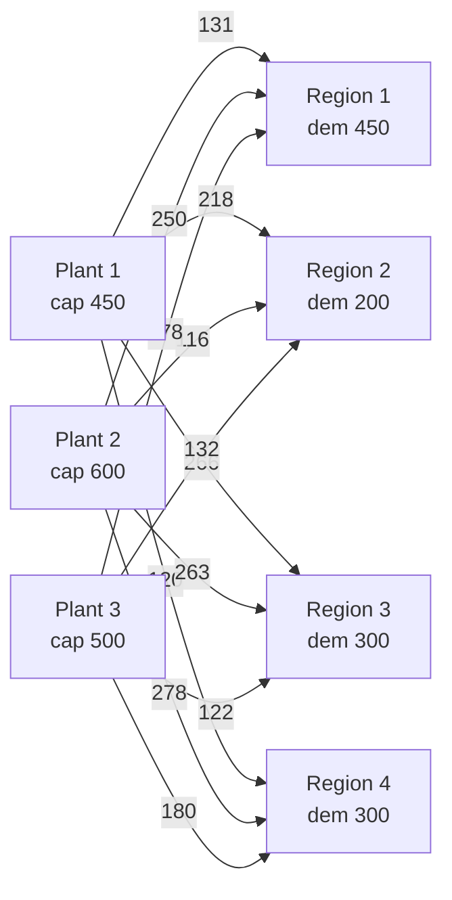

# Grand Prix Automobile: A Transportation Problem

## The problem

The Grand Prix Automobile Company makes cars in three plants and sells them in four regions. Each plant can supply only a limited number of cars, and each region needs a set number of cars. The cost of shipping one car depends on which plant it leaves and which region it goes to.

**Unit shipping cost ($ per car), plant capacities and regional demands**

| From \ To | Region 1 | Region 2 | Region 3 | Region 4 | Capacity |
|---|---:|---:|---:|---:|---:|
| Plant 1 | 131 | 218 | 266 | 120 | 450 |
| Plant 2 | 250 | 116 | 263 | 278 | 600 |
| Plant 3 | 178 | 132 | 122 | 180 | 500 |
| **Demand** | **450** | **200** | **300** | **300** | |

Any plant can ship to any region. Shipments cannot be negative.

**Questions**

1. Represent the problem as a network. How many decision variables and constraints does it have?
2. Formulate it as a linear program.
3. Solve it. What is the cheapest shipping plan, and what does it cost? Which plants run at full capacity?
4. Write the same model in a more general way, as a list of arcs (origin, destination, unit cost), where the supply and demand totals are found by adding up the flow on the arcs that leave or enter each node. Confirm that it gives the same answer.
5. What is one more car of capacity worth at each plant? What does one more car of demand cost in each region?
6. Suppose every region's demand changes by the same percentage, from −20% to +30% in steps of 5%. How does the minimum cost change? What is the largest increase the plants can meet?

---

## Solution

### 1. The network

The plants are supply nodes and the regions are demand nodes. Each plant–region route is an arc, and the number of cars sent along it is the flow on that arc.



- **Decision variables:** 3 × 4 = **12**, one for each arc.
- **Constraints:** **7** (3 capacity constraints and 4 demand constraints), plus non-negativity.

Total capacity is 1,550 cars and total demand is 1,250, so the problem is feasible and 300 cars of capacity will go unused.

### 2. Linear program

Let $x_{ij}$ = number of cars shipped from plant $i$ to region $j$, $c_{ij}$ = unit cost, $S_i$ = capacity of plant $i$, and $D_j$ = demand of region $j$.

$$
\min \; \sum_{i=1}^{3}\sum_{j=1}^{4} c_{ij}\,x_{ij}
$$

subject to

$$
\sum_{j=1}^{4} x_{ij} \le S_i \quad i = 1,2,3 \qquad \text{(outflow of each plant} \le \text{capacity)}
$$

$$
\sum_{i=1}^{3} x_{ij} \ge D_j \quad j = 1,\dots,4 \qquad \text{(inflow to each region} \ge \text{demand)}
$$

$$
x_{ij} \ge 0
$$

The demand constraints use "≥" because shipping more than needed only adds cost, so the optimum never over-ships. Writing them as "=" gives the same answer here.

### 3. Solve: matrix form

The variables are stored as a 3 × 4 grid, flattened row by row. `scipy.optimize.linprog` only accepts "≤" rows, so the "≥" demand rows are multiplied by −1.

```python
import numpy as np
import pandas as pd
from scipy.optimize import linprog

plants = ["Plant 1", "Plant 2", "Plant 3"]
regions = ["Region 1", "Region 2", "Region 3", "Region 4"]

cost = np.array([            # $ per car, rows = plants, columns = regions
    [131, 218, 266, 120],
    [250, 116, 263, 278],
    [178, 132, 122, 180],
])
capacity = np.array([450, 600, 500])
demand = np.array([450, 200, 300, 300])
m, n = cost.shape


def solve_matrix(cost, capacity, demand):
    m, n = cost.shape
    c = cost.flatten()                       # x[i, j] -> index i*n + j

    A_cap = np.kron(np.eye(m), np.ones(n))   # row i: sum over j of x[i, j]
    A_dem = np.kron(np.ones(m), np.eye(n))   # row j: sum over i of x[i, j]

    A_ub = np.vstack([A_cap, -A_dem])        # ">=" rows multiplied by -1
    b_ub = np.concatenate([capacity, -demand])

    return linprog(c, A_ub=A_ub, b_ub=b_ub, bounds=(0, None), method="highs")


res_m = solve_matrix(cost, capacity, demand)
plan = res_m.x.reshape(m, n)

table = pd.DataFrame(plan, index=plants, columns=regions).round(0).astype(int)
table["Shipped"] = table.sum(axis=1)
table["Capacity"] = capacity
table.loc["Received"] = list(plan.sum(axis=0).round(0).astype(int)) + ["", ""]
table.loc["Demand"] = list(demand) + ["", ""]
print(table.to_string())
print(f"\nMinimum total cost: ${res_m.fun:,.0f}")
```

Output:

```
          Region 1  Region 2  Region 3  Region 4 Shipped Capacity
Plant 1        150         0         0       300     450      450
Plant 2        100       200         0         0     300      600
Plant 3        200         0       300         0     500      500
Received       450       200       300       300                 
Demand         450       200       300       300                 

Minimum total cost: $176,050
```

**Answer.** The minimum total shipping cost is **$176,050**. Six of the twelve routes are used:

| Route | Cars | $/car | Cost |
|---|---:|---:|---:|
| Plant 1 → Region 1 | 150 | 131 | 19,650 |
| Plant 1 → Region 4 | 300 | 120 | 36,000 |
| Plant 2 → Region 1 | 100 | 250 | 25,000 |
| Plant 2 → Region 2 | 200 | 116 | 23,200 |
| Plant 3 → Region 1 | 200 | 178 | 35,600 |
| Plant 3 → Region 3 | 300 | 122 | 36,600 |
| **Total** | **1,250** | | **176,050** |

Plants 1 and 3 run at full capacity. Plant 2 ships 300 of its 600 cars, so all of the unused capacity is at Plant 2.

Region 1 is supplied by all three plants. Plant 1 is the cheapest source for both Region 1 ($131) and Region 4 ($120). Sending every region its cheapest route would need 750 cars from Plant 1, which can make only 450. That plan would cost $154,750, so the capacity limits add $21,300. Because Plants 1 and 3 are full, the last 100 cars for Region 1 come from Plant 2 at $250, the most expensive route in the plan.

The flows come out as whole numbers without any integer constraint. This always happens in a transportation problem whose capacities and demands are whole numbers.

### 4. Solve: arc-list (general network) form

Here each arc is one row with its origin, destination and unit cost. A plant's outflow is the sum of the flow on the arcs whose origin is that plant. A region's inflow is the sum of the flow on the arcs whose destination is that region. The boolean masks `origin == p` and `destination == r` do the selecting.

This form is more general than the matrix form. A route that does not exist is simply left out of the list, and an intermediate node such as a warehouse only needs its arcs plus one balance constraint (inflow = outflow).

```python
arcs = [  # (origin plant, destination region, unit cost)
    (1, 1, 131), (1, 2, 218), (1, 3, 266), (1, 4, 120),
    (2, 1, 250), (2, 2, 116), (2, 3, 263), (2, 4, 278),
    (3, 1, 178), (3, 2, 132), (3, 3, 122), (3, 4, 180),
]
origin = np.array([a[0] for a in arcs])
destination = np.array([a[1] for a in arcs])
unit_cost = np.array([a[2] for a in arcs])

plant_ids = [1, 2, 3]
region_ids = [1, 2, 3, 4]

A_out = np.array([(origin == p).astype(float) for p in plant_ids])
A_in = np.array([(destination == r).astype(float) for r in region_ids])

res_f = linprog(
    unit_cost,
    A_ub=np.vstack([A_out, -A_in]),
    b_ub=np.concatenate([capacity, -demand]),
    bounds=(0, None),
    method="highs",
)

flows = pd.DataFrame({
    "Origin": origin,
    "Destination": destination,
    "Unit cost": unit_cost,
    "Flow": res_f.x.round(0).astype(int),
})
flows["Arc cost"] = flows["Unit cost"] * flows["Flow"]
print(flows.to_string(index=False))
print("\nOutflow by plant :", dict(zip(plant_ids, (A_out @ res_f.x).round(0).astype(int).tolist())))
print("Inflow by region :", dict(zip(region_ids, (A_in @ res_f.x).round(0).astype(int).tolist())))
print(f"Minimum total cost: ${res_f.fun:,.0f}")
print("Same answer as matrix form:", np.isclose(res_m.fun, res_f.fun))
```

Output:

```
 Origin  Destination  Unit cost  Flow  Arc cost
      1            1        131   150     19650
      1            2        218     0         0
      1            3        266     0         0
      1            4        120   300     36000
      2            1        250   100     25000
      2            2        116   200     23200
      2            3        263     0         0
      2            4        278     0         0
      3            1        178   200     35600
      3            2        132     0         0
      3            3        122   300     36600
      3            4        180     0         0

Outflow by plant : {1: 450, 2: 300, 3: 500}
Inflow by region : {1: 450, 2: 200, 3: 300, 4: 300}
Minimum total cost: $176,050
Same answer as matrix form: True
```

**Answer.** The arc-list form gives the same plan and the same minimum cost of **$176,050**.

### 5. Shadow prices and reduced costs

The HiGHS solver reports how the optimal cost changes per unit increase in each right-hand side. The demand rows were multiplied by −1, so their sign is flipped back.

```python
duals = res_m.ineqlin.marginals
cap_value = -duals[:m]        # $ saved per extra car of capacity
dem_price = -duals[m:]        # $ added per extra car of demand
reduced = res_m.lower.marginals.reshape(m, n)

for p, v in zip(plants, cap_value):
    print(f"One more car of capacity at {p}: saves ${v:,.0f}")
for r, v in zip(regions, dem_price):
    print(f"One more car demanded in {r}: costs ${v:,.0f}")
print("\nReduced costs (how much a route's cost must fall before it is used):")
print(pd.DataFrame(reduced, index=plants, columns=regions).round(0).astype(int).to_string())
```

Output:

```
One more car of capacity at Plant 1: saves $119
One more car of capacity at Plant 2: saves $0
One more car of capacity at Plant 3: saves $72
One more car demanded in Region 1: costs $250
One more car demanded in Region 2: costs $116
One more car demanded in Region 3: costs $194
One more car demanded in Region 4: costs $239

Reduced costs (how much a route's cost must fall before it is used):
         Region 1  Region 2  Region 3  Region 4
Plant 1         0       221       191         0
Plant 2         0         0        69        39
Plant 3         0        88         0        13
```

**Answer.**

- **Capacity.** An extra car of capacity is worth **$119** at Plant 1 and **$72** at Plant 3. It is worth **$0** at Plant 2, which already has 300 cars to spare.
- **Demand.** One more car demanded costs **$250** in Region 1, **$116** in Region 2, **$194** in Region 3 and **$239** in Region 4.
- **Unused routes.** Every unused route has a positive reduced cost, so the optimal plan is unique. The closest to being used is Plant 3 → Region 4: its cost would have to fall by $13, from $180 to $167.

These values hold only for small changes, inside the allowable ranges of a sensitivity report. For example, Region 1's $250 holds for changes in its demand from −100 to +300 cars.

### 6. What if demand changes?

Every region's demand is multiplied by (1 + change), and the model is solved again.

```python
for pct in np.arange(-0.20, 0.301, 0.05):
    pct = round(pct, 2) + 0.0                # avoid printing "-0%"
    r = solve_matrix(cost, capacity, demand * (1 + pct))
    result = f"${r.fun:,.0f}" if r.status == 0 else "not feasible"
    print(f"{pct:+5.0%}  ->  {result}")
print(f"Largest feasible increase: {capacity.sum() / demand.sum() - 1:.0%} "
      f"(total capacity {capacity.sum():,} vs total demand {demand.sum():,})")
```

Output:

```
 -20%  ->  $130,850
 -15%  ->  $140,350
 -10%  ->  $149,850
  -5%  ->  $162,770
  +0%  ->  $176,050
  +5%  ->  $189,330
 +10%  ->  $202,610
 +15%  ->  $215,890
 +20%  ->  $229,170
 +25%  ->  not feasible
 +30%  ->  not feasible
Largest feasible increase: 24% (total capacity 1,550 vs total demand 1,250)
```

**Answer.**

- **Increases.** From 0% to +20%, the cost rises in a straight line by **$13,280 per 5%**. Each 5% is 62.5 more cars, so the extra cost is $212.48 per car. That figure is the demand-weighted average of the four regional shadow prices: (450×250 + 200×116 + 300×194 + 300×239) ÷ 1,250. The shape of the plan stays the same.
- **Decreases.** Cutting demand saves less per car once demand falls about 10%. At that point Plants 1 and 3 have room to serve Region 1 themselves, so the expensive Plant 2 → Region 1 route is dropped first.
- **Ceiling.** The largest increase the plants can meet is **24%**, where total demand reaches the total capacity of 1,550 cars. At +25% and +30% no plan can meet every region's demand.

---

## Summary of answers

| Question | Answer |
|---|---|
| 1. Size | 12 decision variables (arcs), 7 constraints (3 capacity, 4 demand) |
| 3. Minimum cost | **$176,050** |
| 3. Plan | P1→R1 150, P1→R4 300, P2→R1 100, P2→R2 200, P3→R1 200, P3→R3 300 |
| 3. Full plants | Plants 1 and 3; Plant 2 has 300 cars idle |
| 4. Arc-list form | Same plan, same $176,050 |
| 5. Capacity value | Plant 1 $119, Plant 2 $0, Plant 3 $72 per car |
| 5. Demand cost | Region 1 $250, Region 2 $116, Region 3 $194, Region 4 $239 per car |
| 6. Demand change | +$13,280 per +5% up to +20%; infeasible beyond +24% |

**Note.** An assignment problem, such as assigning professors to courses, has exactly the same structure. Professors take the place of plants, courses take the place of regions, each supply and demand is a small whole number (each course needs one professor), and the flow on each arc comes out 0 or 1. The arc-list code above solves it without any change in logic.

The full script is in `grand_prix_transportation.py` and needs `numpy`, `scipy` (1.6 or later) and `pandas`.
